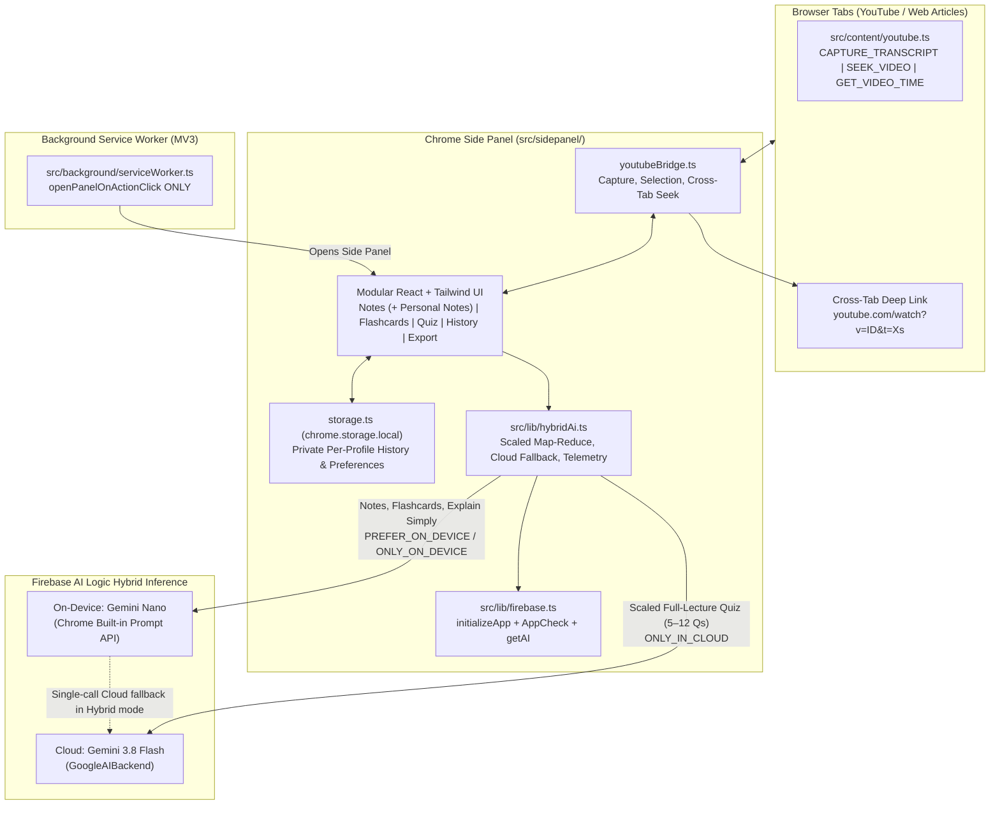

# LectureLens AI

**LectureLens AI** is a Manifest V3 Chrome Side Panel Extension built for **#BuildHybridAI 2026** that turns long YouTube lectures and web articles into **timestamped study notes**, **active-recall flashcards**, **personal notes**, and **full-lecture practice quizzes** using **Firebase AI Logic Hybrid Inference** (`firebase` v12.5.0+).

It runs **on-device with Gemini Nano** (Chrome Built-in Prompt API) for fast, private, zero-rate-limit study generation (`PREFER_ON_DEVICE` / `ONLY_ON_DEVICE`) and seamlessly routes or falls back to **Cloud Gemini 3.8 Flash** (`ONLY_IN_CLOUD` / `inCloudParams`) for full-lecture reasoning when needed.

---

## Problem Statement & Impact

Students, engineers, and lifelong learners regularly watch 30–90+ minute YouTube lectures and read dense technical documentation, yet:
- Scrubbing back through long videos to review definitions or key points wastes time.
- Cloud-only AI tools add network latency, hit free-tier rate limits, and send private study notes to external servers.

**LectureLens AI** solves this right inside Chrome's Side Panel: one click captures the transcript and automatically builds a complete, chapter-filterable study kit—stored **100% locally per Chrome user profile** and ready to review offline.

---

## Firebase AI Logic Hybrid Inference Matrix

| Capability | Policy / Mode | Execution Strategy | Model(s) |
| :--- | :--- | :--- | :--- |
| **Full-Lecture Study Notes & Definitions** | `PREFER_ON_DEVICE` (Hybrid) or `ONLY_ON_DEVICE` (Local-Only) | On-device chapter map-reduce across up to 12 chapters when Gemini Nano is ready; single-call full-lecture Cloud synthesis when Nano is unavailable in Hybrid mode | Gemini Nano ↔ `gemini-3.8-flash` |
| **Active-Recall Flashcards** | `PREFER_ON_DEVICE` (Hybrid) or `ONLY_ON_DEVICE` (Local-Only) | Scaled yield (6–24+ cards based on lecture length) via schema-constrained Nano map-reduce or single-call Cloud fallback | Gemini Nano ↔ `gemini-3.8-flash` |
| **Explain Simply (Peer Tutor)** | `PREFER_ON_DEVICE` / `ONLY_ON_DEVICE` | Instant 2-sentence everyday analogy + key idea on any definition or missed quiz question | Gemini Nano ↔ `gemini-3.8-flash` |
| **Full-Lecture Practice Quiz** | `ONLY_IN_CLOUD` | Evenly samples up to 60,000 chars across start, middle, and end for 5–12 cross-chapter MCQs (skipped automatically in Local-Only or offline mode) | `gemini-3.8-flash` |
| **Backend Abuse Protection** | `firebase/app-check` | MV3-safe debug token attestation via `CustomProvider` (no external reCAPTCHA script blocked by `script-src 'self'`) or `ReCaptchaV3Provider` on HTTPS web origins | Firebase App Check |

---

## Key Features

- **One-Click Capture-to-Study-Kit Pipeline**: Clicking **Capture YouTube Transcript** automatically generates **Notes → Flashcards → Quiz** (skipping Cloud Quiz in `Local-Only` or offline mode), with an **Auto-generate study kit** toggle and mid-run **Cancel** support.
- **Scaled Full-Lecture Yields & Non-Destructive Chapter Filtering**: Automatically scales output from short clips up to 39m+ lectures (~16–22 takeaways, ~10–15 definitions, ~18–24 flashcards, 12 quiz questions). The **Chapter Filter** dropdown defaults to **All Chapters** and filters Notes, Flashcards, and Quiz items cleanly—plus a **Deep-Dive Chapter (+More)** action to merge extra notes or flashcards from any specific chapter.
- **Timestamped Personal Notes**: Add, edit, and delete your own study notes inside the **Notes** tab, with a one-click **Use Video Time** button (`GET_VIDEO_TIME`) that stamps the active YouTube player's exact timestamp.
- **Smart Cross-Tab YouTube Timestamp Deep-Linking**: Clicking any `[mm:ss]` chip seeks the active YouTube tab in-place, focuses & seeks another open tab playing that video, or opens `https://www.youtube.com/watch?v={id}&t={seconds}s` in a new tab when reviewing past sessions from any other webpage.
- **Searchable Local Study History (`chrome.storage.local`)**: Every parsed lecture is saved **100% locally in the user's Chrome profile** (private & offline-capable) with title/URL search, clickable source links, capture date/time, completion badges, and profile storage usage stats.
- **Complete Markdown Export (`Copy Markdown` & `Download .md`)**: Exports everything—source metadata, Hybrid AI telemetry summary, overview, takeaways, definitions + Nano analogies, personal notes, flashcards with mastery flags, and the full practice quiz with answer key & clickable YouTube timestamp links.
- **Live Telemetry & First-Click Nano Pre-Warming**: Tracks `result.response.inferenceSource` and `performance.now()` latency per call, supports one-click Chrome flag/component troubleshooting, and pre-warms Gemini Nano download on first panel interaction.
- **Unified Brand Design & WCAG 2.1 AA Accessibility**: Unified vector brand logo & extension icons (`16/32/48/128px`), responsive Side Panel layout (`max-w-2xl`), finger-pointer cursors, skip-to-content link, WAI-ARIA `tablist`/`tab`/`tabpanel` with arrow-key navigation, modal focus trapping, non-color-only quiz feedback, and `prefers-reduced-motion` support.

---

## Hybrid AI Architecture



> **Why Side Panel execution?** Chrome's Built-in Prompt API (`LanguageModel` / Gemini Nano) requires a window/document context and is unavailable in MV3 service workers. All `firebase/ai` and `firebase/app-check` calls execute inside `src/sidepanel/`.

---

## Prerequisites & Setup

### 1. Enable Gemini Nano in Chrome (On-Device AI)

Use **Chrome 138+** on desktop with at least 22 GB free disk space and >4 GB VRAM (or 16 GB RAM + 4+ CPU cores):

1. Open `chrome://flags/#optimization-guide-on-device-model` and set it to **Enabled BypassPerfRequirement**.
2. Open `chrome://flags/#prompt-api-for-gemini-nano` and set it to **Enabled**.
3. Relaunch Chrome.
4. Open `chrome://on-device-internals` → **Model Status** (or `chrome://components`) to confirm Gemini Nano is downloaded/ready.

### 2. Configure Firebase AI Logic & App Check

1. Create or select a project in the [Firebase Console](https://console.firebase.google.com/).
2. Enable **Firebase AI Logic** (Gemini Developer API provider) under **Build → AI Logic**.
3. Register a Web App (`Project Settings → Your apps`) to obtain your `VITE_FIREBASE_*` config values.
4. Copy `.env.example` to `.env`:
   ```bash
   cp .env.example .env
   ```
5. Fill in `.env` with your Firebase Web App credentials and App Check settings:
   - `VITE_FIREBASE_RECAPTCHA_SITE_KEY`: Your reCAPTCHA v3 site key from Firebase App Check.
   - `VITE_APPCHECK_DEBUG_TOKEN`: Set to `true` for local unpacked extension development (or paste a registered debug UUID).
6. When `VITE_APPCHECK_DEBUG_TOKEN=true`, open DevTools inside the **LectureLens AI Side Panel** (`Right-click Side Panel → Inspect`), copy the logged `App Check debug token` UUID, and register it under **Firebase Console → App Check → Apps → Manage debug tokens**.

---

## Local Development, Tests & Build

```bash
# 1. Install dependencies
npm install

# 2. Run strict TypeScript typechecking
npm run typecheck

# 3. Run Vitest unit tests (hybrid routing, scaling, exporters, storage, YouTube bridge & parsers)
npm test

# 4. Build production Manifest V3 extension into dist/
npm run build
```

---

## Installing the Unpacked Extension in Chrome

1. Run `npm run build` so the compiled MV3 bundle is generated in `dist/`.
2. Open `chrome://extensions` in Chrome.
3. Enable **Developer mode** (top-right toggle).
4. Click **Load unpacked** and select the `dist/` directory inside this repository.
5. Pin **LectureLens AI** to your Chrome toolbar and click its icon to open the Side Panel.

---

## Usage Guide

1. **Capture Content**: Navigate to any `youtube.com/watch?v=...` lecture and click **Capture YouTube Transcript** (or expand **Paste / Selected Text** to grab highlighted text from any webpage).
2. **Automatic Study Kit & Chapter Filtering**: LectureLens AI automatically extracts **Notes**, **Flashcards**, and (in Hybrid mode) a **Practice Quiz** across the full video. Use **Chapter Filter** to focus on a specific section or click **Deep-Dive Chapter (+More)** for extra coverage.
3. **Add Personal Notes & Jump to Video Moments**: Add your own notes (with one-click **Use Video Time**) in **Notes**. Click any `[mm:ss]` timestamp chip—even from a saved session in **History** while browsing another site—to jump straight to that second in YouTube.
4. **Practice & Tutor Loop**: Drill **Flashcards** (`Space` flip, `←`/`→` navigate, `M` mark mastered) and take the **Quiz** (`Explain Simply (Nano)` gives instant plain-English analogies on-device).
5. **Export Complete Study Guide**: Click **Copy Markdown** or **Download `.md`** in the bottom bar to save all notes, personal notes, flashcards, quiz questions, and clickable YouTube links.

---

## License

Licensed under the [Apache License 2.0](LICENSE).
