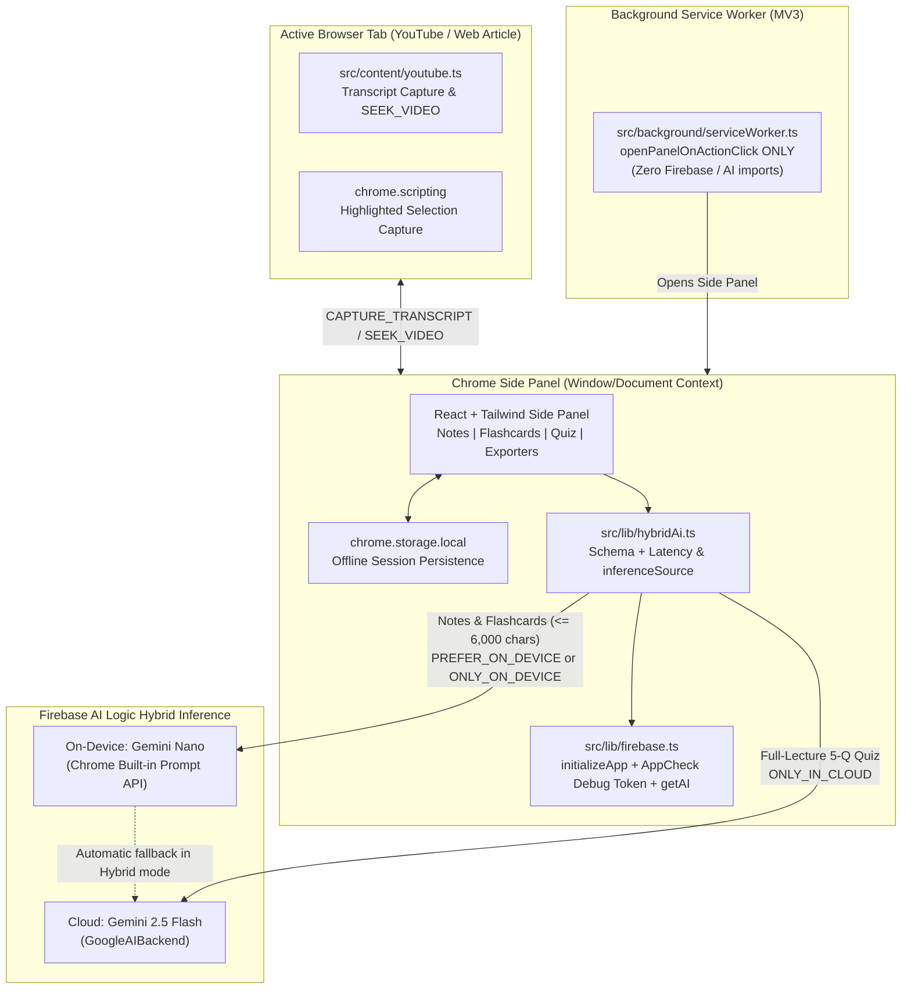

# LectureLens AI

**LectureLens AI** is a Manifest V3 Chrome Extension that transforms YouTube lectures and web articles into **timestamped study notes**, **active-recall flashcards**, and **full-lecture practice quizzes** using **Firebase AI Logic Hybrid Inference** (`firebase` v12.5.0+).

It runs **on-device with Gemini Nano** (Chrome Built-in Prompt API) for fast, private chapter extraction (`PREFER_ON_DEVICE` / `ONLY_ON_DEVICE`) and seamlessly delegates or falls back to **Cloud Gemini 2.5 Flash** (`inCloudParams` / `ONLY_IN_CLOUD`) for full-lecture reasoning.

---

## Key Features

- **Explicit Hybrid Routing (`src/lib/hybridAi.ts`)**:
  - **On-Device First (`InferenceMode.PREFER_ON_DEVICE`)**: Study Notes, Key Definitions, and Active-Recall Flashcards on segments up to `6,000` characters, with explicit `inCloudParams: { model: "gemini-2.5-flash" }` fallback.
  - **Strict Local-Only Privacy Toggle**: Switches notes & flashcards to `InferenceMode.ONLY_ON_DEVICE` with zero cloud egress and clear Chrome flag recovery guidance if Gemini Nano is not yet downloaded.
  - **Cloud Synthesis (`InferenceMode.ONLY_IN_CLOUD`)**: Generates a 5-question multiple-choice practice quiz across full-length transcripts (`gemini-2.5-flash`).
- **Guaranteed Structured JSON (`Schema`)**: Every `generateContent` call enforces `responseMimeType: "application/json"` and `responseSchema` (plus `onDeviceParams.promptOptions.responseConstraint` for Gemini Nano).
- **Live Telemetry & Inference Verification**: Inspects `result.response.inferenceSource` and `performance.now()` latency on every call, displaying a live header badge (`⚡ On-Device (Gemini Nano) • 380ms` or `☁️ Cloud (Gemini) • 1.6s`) and call log.
- **One-Click YouTube Transcript Capture & Video Seeking**: Captures timestamped captions directly from `youtube.com` and lets you click any `[mm:ss]` chip in Notes, Flashcards, or Quiz explanations to jump straight to that moment in the video.
- **Article / Text Capture & Smart Chapter Windowing**: Grab highlighted text from any page or paste notes; transcripts over `6,000` chars automatically split into time-labeled Nano chapters while keeping the full transcript ready for the Cloud Quiz.
- **Offline Persistence & Export**: Auto-saves sessions per video/document in `chrome.storage.local`, copies formatted Markdown, and exports RFC-4180 Anki `.csv` decks (`front,back`).

---

## Hybrid AI Architecture



> **Why Side Panel execution?** Chrome's Built-in Prompt API (`LanguageModel` / Gemini Nano) requires a window/document context and is unavailable in MV3 service workers. All `firebase/ai` and `firebase/app-check` calls execute inside `src/sidepanel/`.

---

## Prerequisites & Setup

### 1. Enable Gemini Nano in Chrome (On-Device AI)

Use **Chrome 138+** (Stable, Beta, Dev, or Canary) on desktop with at least 22 GB free disk space and >4 GB VRAM (or 16 GB RAM + 4+ CPU cores):

1. Open `chrome://flags/#optimization-guide-on-device-model` and set it to **Enabled BypassPerfRequirement**.
2. Open `chrome://flags/#prompt-api-for-gemini-nano` and set it to **Enabled**.
3. Relaunch Chrome.
4. Open `chrome://on-device-internals` → **Model Status** to confirm Gemini Nano is downloaded/ready (or trigger download via DevTools console: `await LanguageModel.create()`).

### 2. Configure Firebase AI Logic & App Check

1. Create or select a project in the [Firebase Console](https://console.firebase.google.com/).
2. Enable **Firebase AI Logic** (Gemini Developer API provider) under **Build → AI Logic**.
3. Register a Web App (`Project Settings → Your apps`) to obtain your `VITE_FIREBASE_*` config values.
4. Copy `.env.example` to `.env`:
   ```bash
   cp .env.example .env
   ```
5. Fill in `.env` with your Firebase Web App credentials and App Check settings:
   - `VITE_FIREBASE_RECAPTCHA_SITE_KEY`: Your reCAPTCHA v3 site key from Firebase App Check.
   - `VITE_APPCHECK_DEBUG_TOKEN`: Set to `true` for local unpacked extension development (or paste a registered debug UUID).
6. When `VITE_APPCHECK_DEBUG_TOKEN=true`, open DevTools inside the **LectureLens AI Side Panel** (`Right-click Side Panel → Inspect`), copy the logged `App Check debug token` UUID, and register it under **Firebase Console → App Check → Apps → Manage debug tokens**.

---

## Local Development, Tests & Build

```bash
# 1. Install dependencies
npm install

# 2. Run strict TypeScript typechecking
npm run typecheck

# 3. Run Vitest unit tests (hybrid routing, telemetry, exporters, YouTube parsers)
npm test

# 4. Build production Manifest V3 extension into dist/
npm run build
```

---

## Installing the Unpacked Extension in Chrome

1. Run `npm run build` so the compiled MV3 bundle is generated in `dist/`.
2. Open `chrome://extensions` in Chrome.
3. Enable **Developer mode** (top-right toggle).
4. Click **Load unpacked** and select the `dist/` directory inside this repository.
5. Pin **LectureLens AI** to your Chrome toolbar and click its icon to open the Side Panel.

---

## Usage Guide

1. **Capture Content**: Navigate to any `youtube.com/watch?v=...` lecture and click **Capture YouTube Transcript** (or expand **Paste / Selected Text** to grab highlighted text or click **Sample** for a built-in demo lecture).
2. **Generate Notes & Flashcards (On-Device First)**:
   - On the **Notes** tab, click **Extract Key Notes & Terms** (`PREFER_ON_DEVICE`). Click any `[mm:ss]` timestamp chip to seek the YouTube player directly.
   - On the **Flashcards** tab, click **Create Active-Recall Cards**, flip cards to test recall, and mark cards as **Mastered**.
3. **Test Strict Local-Only Mode**: Toggle **Local-Only** in the header to enforce `InferenceMode.ONLY_ON_DEVICE` and verify offline privacy (with zero cloud calls).
4. **Generate Full-Lecture Quiz (Cloud)**: Switch to the **Quiz** tab and click **Generate Full-Lecture Quiz (Cloud)** (`ONLY_IN_CLOUD` using `gemini-2.5-flash`) for 5 cross-chapter MCQs with instant explanations and timestamp jumps.
5. **Export & Offline Restore**: Use **Copy Markdown** or **Export Anki CSV** in the bottom bar. Closing and reopening the Side Panel automatically restores your latest session from `chrome.storage.local`.

---

## License

Licensed under the [Apache License 2.0](LICENSE).
